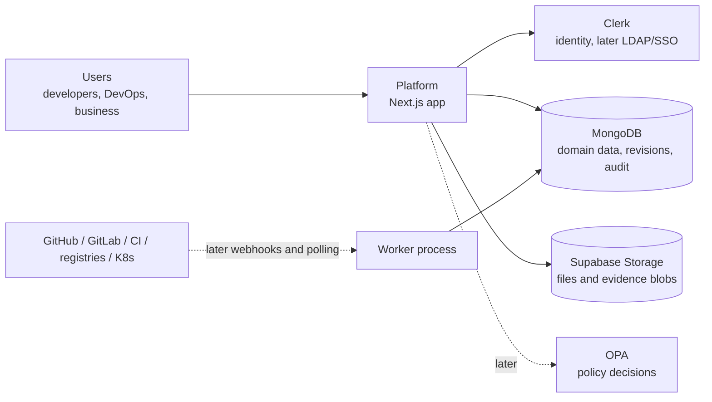
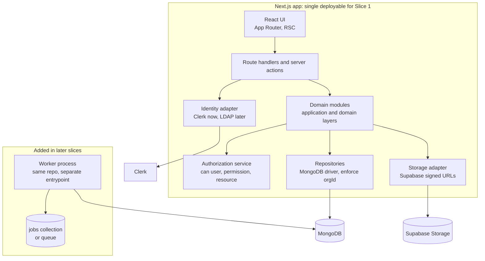
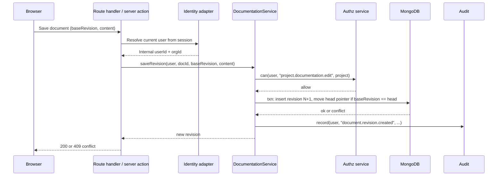

# 01. Architecture Overview

## 1. System context



Solid lines are Slice 1. Dotted lines come in later slices.

## 2. Container view



## 3. Architectural style: modular monolith

One repository, one Next.js deployable, strict module boundaries. Modules map to the product spec's conceptual modules (spec section 12) and can be extracted later if needed.

Rules:

1. **UI and route handlers never touch MongoDB directly.** They call module application services.
2. **Every module owns its collections.** Other modules go through its public interface, not its collections.
3. **Authorization is a cross-cutting service**, called by application services (not by the UI alone).
4. **Every query is tenant-scoped** by `organizationId`. The repository base class injects it, so a missed filter is a compile-time/structural problem rather than a code-review problem.
5. **Domain events** are emitted by application services (in-process in Slice 1) so audit, search indexing, and later governance can subscribe without coupling.

### Module map

| Module | Slice | Owns |
|---|---|---|
| `access` | 1 | users, teams, memberships, roles, role assignments |
| `inventory` | 1 | organizations, systems, projects |
| `documentation` | 1 | documents, document revisions, attachments |
| `audit` | 1 | append-only audit log |
| `resources` | 2 | resources, resource relationships, type definitions |
| `validation` | 3 | constraint definitions, validation runs |
| `changes` | 5 | change sets, reviews, approvals |
| `integrations` | 6+ | integrations, sync jobs, observations |
| `reconciliation` | 7+ | desired/observed state, drift records |
| `evidence` | 7+ | evidence records |

## 4. Proposed repository layout

```text
/
├─ docs/                      architecture package (this folder)
├─ src/
│  ├─ app/                    Next.js App Router (UI + route handlers only)
│  │  ├─ (auth)/              sign-in, sign-up
│  │  ├─ (app)/               authenticated shell
│  │  │  ├─ systems/[id]/...
│  │  │  ├─ projects/[id]/...
│  │  │  └─ docs/[id]/...
│  │  └─ api/                 route handlers (thin)
│  ├─ modules/
│  │  ├─ access/
│  │  │  ├─ domain/           entities, permission catalog, pure rules
│  │  │  ├─ application/      use cases (services)
│  │  │  ├─ infrastructure/   mongo repositories
│  │  │  └─ index.ts          public interface of the module
│  │  ├─ inventory/ ...
│  │  ├─ documentation/ ...
│  │  └─ audit/ ...
│  ├─ platform/               cross-cutting: db client, authz, storage, identity, events, config
│  │  ├─ db/
│  │  ├─ authz/
│  │  ├─ storage/
│  │  ├─ identity/            IdentityProvider port + Clerk adapter
│  │  └─ events/
│  └─ worker/                 (later) separate entrypoint for jobs
├─ tests/
└─ package.json
```

Dependency direction: `app` → `modules/*/application` → `modules/*/domain`; `infrastructure` implements ports defined by `domain`/`application`. `platform` is imported by modules, never the reverse.

## 5. Typical request flow (edit a document)



The optimistic concurrency check (`baseRevision == head`) is what later lets the change-governance model detect stale baselines.

## 6. Deployment (initial)

- Next.js on a Node host (container or Vercel). Slice 1 has no long-running work, so either works.
- MongoDB as a **replica set** (Atlas or self-hosted). This is required for multi-document transactions, which the revision and approval flows depend on.
- Supabase project used only for private Storage buckets.
- Environments: local (docker-compose Mongo replica set), staging, production.

The worker introduced in Slice 6 should **not** run inside Next.js route handlers. It will be a separate long-lived Node process from the same codebase.
