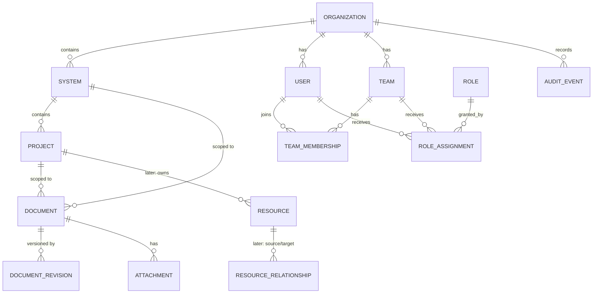

# 03. Domain and Data Model

## 1. Conventions

- Every document: `_id` (ObjectId), `organizationId`, `schemaVersion`, `createdAt`, `createdBy`, `updatedAt`, `updatedBy`.
- Entity references are ObjectIds, never embedded copies (except small denormalized display names, marked as such).
- Soft lifecycle via `status` instead of deletion. Immutable collections (`document_revisions`, `audit_events`) have no update or delete path.
- Human-friendly `key` (slug) on systems, projects, documents; unique per organization.
- Every collection's compound indexes start with `organizationId`.

## 2. Entity-relationship overview

Solid boxes are built in Slice 1. Dashed boxes (in the notes) arrive later but the model is shaped to receive them.



## 3. Slice 1 collections

### `organizations`
```ts
{ _id, key, name, settings: { ... }, status: 'active'|'suspended', ... }
```

### `users`
```ts
{
  _id, organizationId,
  email, displayName,
  externalIdentities: [{ provider: 'clerk'|'ldap', subject: string }],
  status: 'invited'|'active'|'disabled',
  ...
}
```
Indexes: `{organizationId, email}` unique; `{externalIdentities.provider, externalIdentities.subject}` unique sparse.

### `teams` and `team_memberships`
```ts
teams:            { _id, organizationId, key, name, parentTeamId?, source: 'manual'|'directory' }
team_memberships: { _id, organizationId, teamId, userId, role: 'member'|'lead', source }
```
`source` marks whether the record is managed manually or synced from a directory (LDAP later), so manual edits do not fight sync.

### `systems`
```ts
{
  _id, organizationId, key, name, description,
  ownerTeamId, status: 'proposed'|'active'|'deprecated'|'retired',
  classification: 'public'|'internal'|'confidential'|'restricted'
}
```

### `projects`
```ts
{
  _id, organizationId, systemId, key, name, purpose,
  ownerTeamId, status: 'proposed'|'active'|'deprecated'|'retired',
  classification
}
```
Containment rule: a project belongs to exactly one system for ownership. Cross-project sharing is modeled later via resource relationships, not by multiple parents.

### `documents`
```ts
{
  _id, organizationId, key, title,
  scope: { type: 'organization'|'system'|'project', id: ObjectId },
  docType: 'architecture'|'adr'|'runbook'|'user-guide'|'onboarding'|'design'|'other',
  audience: ['developer'|'devops'|'business'|...],   // relevance, not permission
  classification,
  headRevision: number,           // pointer to latest authoritative revision
  authority: 'authoritative'|'draft',   // placeholder for the documentation-authority dimension
  status: 'active'|'archived'
}
```
Indexes: `{organizationId, scope.type, scope.id, docType}`, `{organizationId, key}` unique, text index on title for search (full content search later).

`audience` drives **relevance** (what to show first); permissions are enforced separately.

### `document_revisions` (immutable)
```ts
{
  _id, organizationId, documentId,
  revision: number,                 // 1,2,3... monotonically increasing per document
  baseRevision: number|null,        // revision this one was edited from
  contentFormat: 'markdown',
  content: string,
  contentHash: string,              // sha256, for dedupe and integrity
  message?: string,                 // edit summary
  authorId, createdAt,
  changeSetId?: ObjectId            // null in Slice 1; set when ChangeSets arrive
}
```
Indexes: `{organizationId, documentId, revision}` unique.

### `attachments`
```ts
{
  _id, organizationId, documentId?, scope,
  storage: { provider: 'supabase', bucket, path },
  fileName, contentType, sizeBytes, sha256,
  uploadedBy, uploadedAt, status: 'pending'|'available'|'quarantined'
}
```

### `roles`, `role_assignments`
See doc 04.

### `audit_events` (append-only)
```ts
{
  _id, organizationId, at,
  actor: { type: 'user'|'system'|'integration', id },
  action: string,                    // e.g. 'document.revision.created'
  target: { type: string, id: ObjectId },
  scope?: { type, id },
  before?: object, after?: object,   // minimal diffs, never secrets
  requestId, ip?, reason?
}
```
Indexes: `{organizationId, at}`, `{organizationId, target.type, target.id, at}`.

## 4. Later collections (designed now, built later)

These are specified so Slice 1 choices do not block them.

### `resource_types` (Slice 2)
Declarative type definitions: allowed properties (JSON Schema), allowed and required relationships, and applicable constraints.

### `resources` (Slice 2)
```ts
{
  _id, organizationId, name, resourceType, projectIds: ObjectId[],   // shared resources allowed
  lifecycle: 'proposed'|'registered'|'provisioned'|'active'|'deprecated'|'retired',
  external: boolean, managedByTeamId?,
  classification, ownerTeamId,
  details: { ... },                 // type-specific, validated against resource_types
  fieldAuthority: {                  // per-field source of truth (spec section 6)
    '<fieldPath>': { source, manualOverrideAllowed, lastObservedAt, trust, stale }
  }
}
```
Type-specific details are embedded in `details`, validated per type. This replaces the spec's separate `RepositoryDetails`, `PipelineDetails` tables, which fits Mongo naturally.

### `resource_relationships` (Slice 2)
```ts
{ _id, organizationId, sourceResourceId, targetResourceId, relationshipType, metadata }
```
Indexes: `{organizationId, sourceResourceId, relationshipType}` and `{organizationId, targetResourceId, relationshipType}`. Traversal uses `$graphLookup` with a depth cap. Containment is **not** stored here; it lives on the entities (`systemId`, `projectIds`).

### Governance and sync (Slice 5+)
`change_sets`, `change_reviews`, `exceptions`, `constraint_definitions`, `integrations`, `sync_jobs`, `observations`, `desired_states`, `drift_records`, `evidence`. Shapes follow spec sections 7 to 11; they get their own detailed docs when their slice starts.

## 5. Classification and sensitivity

`classification` exists on systems, projects, documents, and (later) resources from the start. Authorization (doc 04) can restrict by classification. Credentials and secrets are **never stored in the platform**; a resource can hold a *reference* to a secret manager entry plus metadata.

## 6. Integrity rules enforced in services (no FKs in Mongo)

- `project.systemId` must exist in the same organization.
- `document.scope.id` must reference an existing, non-retired entity of that type and organization.
- A document's `headRevision` must equal the max `revision` in `document_revisions` for it.
- Entities cannot be hard-deleted while referenced; they move to `retired`/`archived`.
- A nightly integrity job (Slice 1 stretch, mandatory by Slice 3) reports dangling references.
