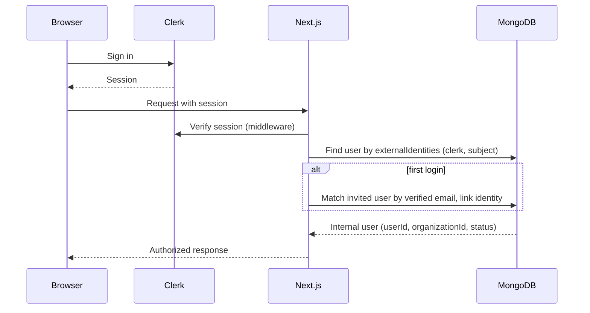

# 04. Authentication and Authorization

## 1. Authentication

### Now: Clerk
Clerk authenticates users and manages sessions. The app never trusts Clerk for permissions.



Rules:
- Users must be **pre-provisioned or invited** into an organization. First login links the Clerk identity to the invited internal user by verified email. No auto-join.
- Disabled internal users are rejected even if Clerk still authenticates them.
- Internal `userId` is the identity used in audit records, role assignments, and ownership.

### Later: LDAP / enterprise directory
Two separate concerns:

1. **Login**: SSO via SAML/OIDC against the enterprise IdP, or a replaced auth provider. Handled by swapping the `IdentityProvider` adapter.
2. **Directory sync** (users, groups → teams): a worker job that upserts `users` and `teams`/`team_memberships` with `source: 'directory'`. Group-to-role mappings are configured in our DB.

The authorization model below is the same either way.

## 2. Authorization model

Concepts (from spec section 4): **User, Role, Permission, Scope, Team**.

- **Permission**: a string action, `<resource>.<subresource>.<action>`, from a code-defined catalog.
- **Role**: a named set of permissions (system roles shipped, custom roles later).
- **Role assignment**: grants a role to a user or team **at a scope**.
- **Scope**: `organization`, `system`, or `project` (later also `resource`, `environment`).
- **Inheritance**: a grant at a scope applies to everything contained below it (organization → system → project → documents/resources).
- **Deny rules**: explicit denies override allows. Used for classification limits and secrets.

### Collections

```ts
roles: {
  _id, organizationId, key, name,
  permissions: string[],          // allow list from catalog
  isSystem: boolean
}

role_assignments: {
  _id, organizationId,
  subject: { type: 'user'|'team', id },
  roleId,
  scope: { type: 'organization'|'system'|'project', id },
  conditions?: { maxClassification?: string, environments?: string[] },
  deny?: string[],                 // explicit denies for this assignment
  grantedBy, grantedAt, expiresAt?
}
```
Index: `{organizationId, subject.type, subject.id}` and `{organizationId, scope.type, scope.id}`.

### Evaluation

```text
can(user, permission, target):
  1. Load the target's ancestry chain (project -> system -> organization) and its classification.
  2. Collect assignments for the user and the user's teams whose scope is in that chain and not expired.
  3. If any matching assignment denies the permission -> DENY.
  4. If the target's classification exceeds the maximum allowed by every matching assignment's conditions -> DENY.
  5. If any matching assignment's role grants the permission -> ALLOW.
  6. Otherwise DENY (default deny).
```

Also needed for list screens: `accessibleScopes(user, permission)` returns the set of systems/projects the user can see, so list queries filter in the database rather than fetching and filtering in memory.

### Single enforcement point
All checks go through `platform/authz`. Application services call `authz.require(user, permission, target)`. The UI may hide controls for convenience but is never the control.

## 3. Slice 1 permission catalog (draft)

```text
organization.read / organization.manage
user.read / user.invite / user.manage
team.read / team.manage
role.read / role.assign
system.read / system.create / system.edit / system.retire
project.read / project.create / project.edit / project.retire
project.documentation.read / project.documentation.edit / project.documentation.publish
system.documentation.read / system.documentation.edit
attachment.upload / attachment.download
audit.read
```

Reserved for later (naming locked now to avoid churn): `service.architecture.read`, `database.schema.read`, `database.configuration.read`, `database.credentials.read` (always explicit deny by default), `deployment.read|create|activate`, `policy.read|edit`, `policy.exception.approve`, `change.propose|review|approve`.

## 4. Default system roles

| Role | Intent | Highlights |
|---|---|---|
| Org Admin | Manage org, users, roles | all `organization/user/team/role` perms, full read |
| System Owner | Own a system and its projects | edit system/projects, publish docs |
| Project Maintainer | Maintain a project | edit project, edit and publish docs |
| Contributor | Write docs | `documentation.edit` (drafts), read |
| Reader (Business) | View purpose, guides | read project/system, read user-guide docs |
| Auditor | Read audit and history | `audit.read`, read-only everywhere |

## 5. Relevance vs permission

Permissions decide **what a person may see**. Relevance decides **what shows first**: derived from team membership, owned systems and projects, role, and a document's `audience`. Onboarding views are built from relevance filtered through permission. A dedicated relevance/onboarding design comes with the onboarding feature, not Slice 1.

## 6. Security notes

- Server-side checks on every route handler and server action, including file signed-URL issuance.
- Audit every permission-relevant event: role changes, grants, denied sensitive access attempts.
- Rate limit sign-in-adjacent and file endpoints.
- Do not log document content or tokens.
- Clerk webhook (user created/deleted/updated) handled idempotently when added; not required for Slice 1.
