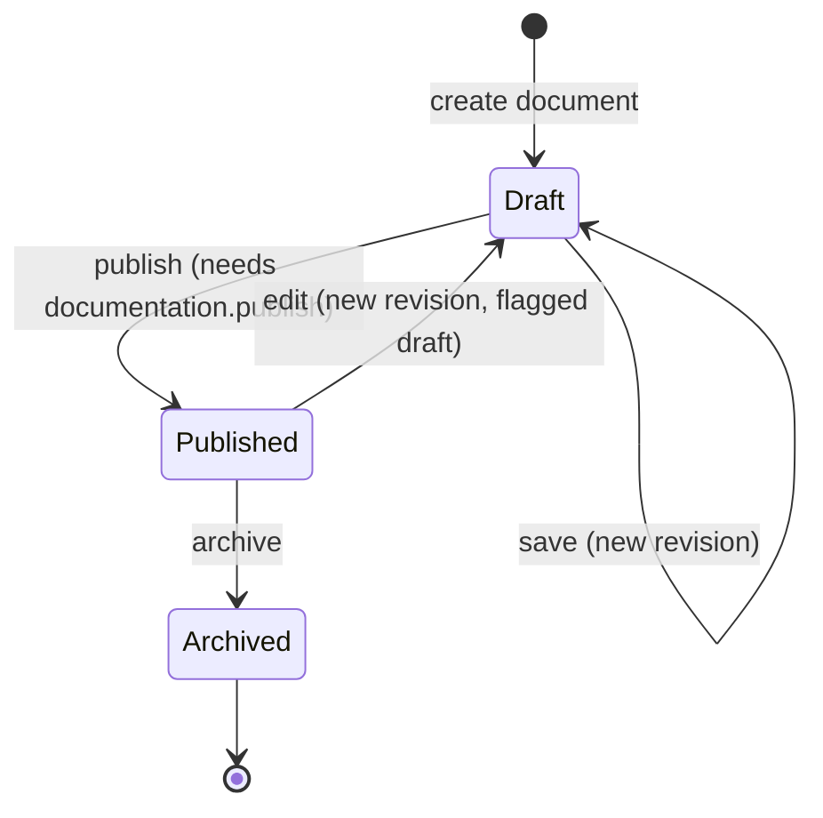
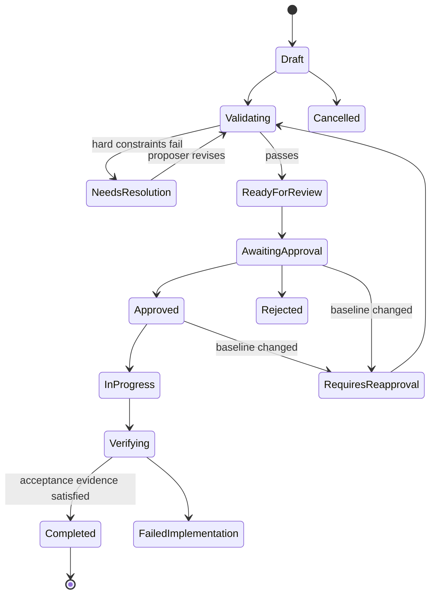

# 05. Versioning and Change Model

This doc covers what Slice 1 implements (document revisions and audit) and the governance design it must remain compatible with (ChangeSets, state machine, baseline views from spec sections 8 to 10).

## 1. Slice 1: immutable document revisions

- A document has a sequence of immutable revisions: 1, 2, 3...
- `documents.headRevision` points to the current one.
- Saving requires the client's `baseRevision`. If it is not the current head, the save is rejected with a conflict (409) and the UI offers a diff and merge. No silent overwrite.
- A save writes revision N+1 and moves `headRevision` in one MongoDB transaction.
- Reverting creates a *new* revision whose content equals an old one. History is never rewritten.
- Every save emits an audit event.



Draft vs published in Slice 1 is a simple flag on the document (`authority`), which is the seed of the spec's *documentation authority* dimension.

## 2. Governance model (future), and how Slice 1 stays compatible

### Compatibility points built in now

| Future need | Slice 1 provision |
|---|---|
| Baseline version a proposal is based on | `baseRevision` on every revision and on every save |
| Link revisions to a ChangeSet | nullable `changeSetId` on `document_revisions` |
| Stable baseline vs proposed vs approved | `authority` on documents; revisions are immutable so any can be referenced as baseline |
| Audit and who/what/why | append-only `audit_events` with `reason` field |
| Immutable history | revisions and audit have no update/delete paths |
| Permission-gated transitions | permission catalog already includes publish/approve naming |

### ChangeSet (Slice 5)

A ChangeSet is a versioned bundle of proposed document revisions and resource changes, reviewed and approved as a unit.

```ts
change_sets: {
  _id, organizationId, key,            // CHG-1042
  title, description, proposerId,
  baseline: { versionRefs: [...] },     // what the change was built against
  items: [{ kind: 'document'|'resource'|'relationship', targetId, proposedRevisionRef | proposedPatch }],
  governance:     'draft'|'proposed'|'approved'|'rejected'|'emergency'|'retrospective_pending',
  implementation: 'not_started'|'in_progress'|'partial'|'implemented'|'failed',
  verification:   'unverified'|'partial'|'verified'|'failed'|'stale',
  docAuthority:   'proposed'|'authoritative'|'superseded',
  validation: { lastRunAt, results: [...] },
  approvals: [...], evidenceIds: [...]
}
```

Four independent dimensions rather than one `status` (spec 8.4).

### Workflow state machine (governance dimension, simplified)



Each transition has: required permission, guard conditions, an audit record. The exact table is finalized when Slice 5 starts (spec section 16 lists it as an open decision).

### Views (spec section 9)

The platform derives, not stores, three views from immutable revisions:

1. **Stable baseline**: last completed and verified revision set.
2. **Approved target**: approved ChangeSets not yet completed, shown as overlays.
3. **Current authoritative operational view**: baseline plus finalized changes plus marked emergency changes.

Observed/drift data is a separate layer shown alongside, never merged in.

### Emergency changes (Slice 11+)
A distinct path: an authorized operator records the change; the operational view updates promptly with an emergency marker; retrospective review is mandatory. Built on the same ChangeSet with `governance: 'emergency'`.

### Concurrency
A ChangeSet records the baseline versions it touched. If any referenced baseline moves before approval, the ChangeSet moves to *Requires Reapproval* and is revalidated. Unrelated ChangeSets proceed independently.

## 3. Audit

`audit_events` is the cross-cutting history record. Slice 1 records: auth link events, user/team/role changes, system/project CRUD, document create/revise/publish/archive, attachment upload/download. Later slices add validation results, policy decisions, exceptions, approvals, evidence, and sync outcomes (spec section 11).
